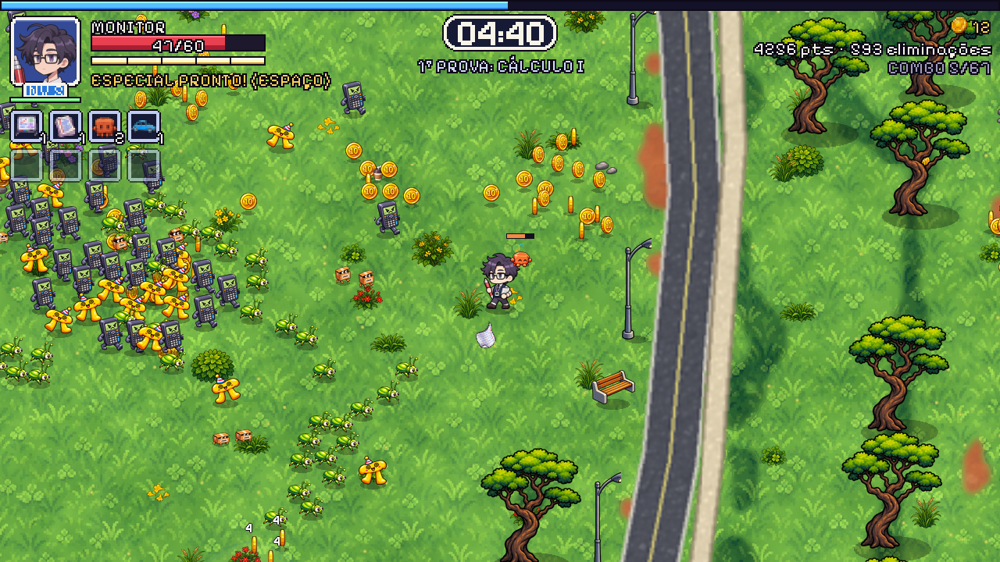
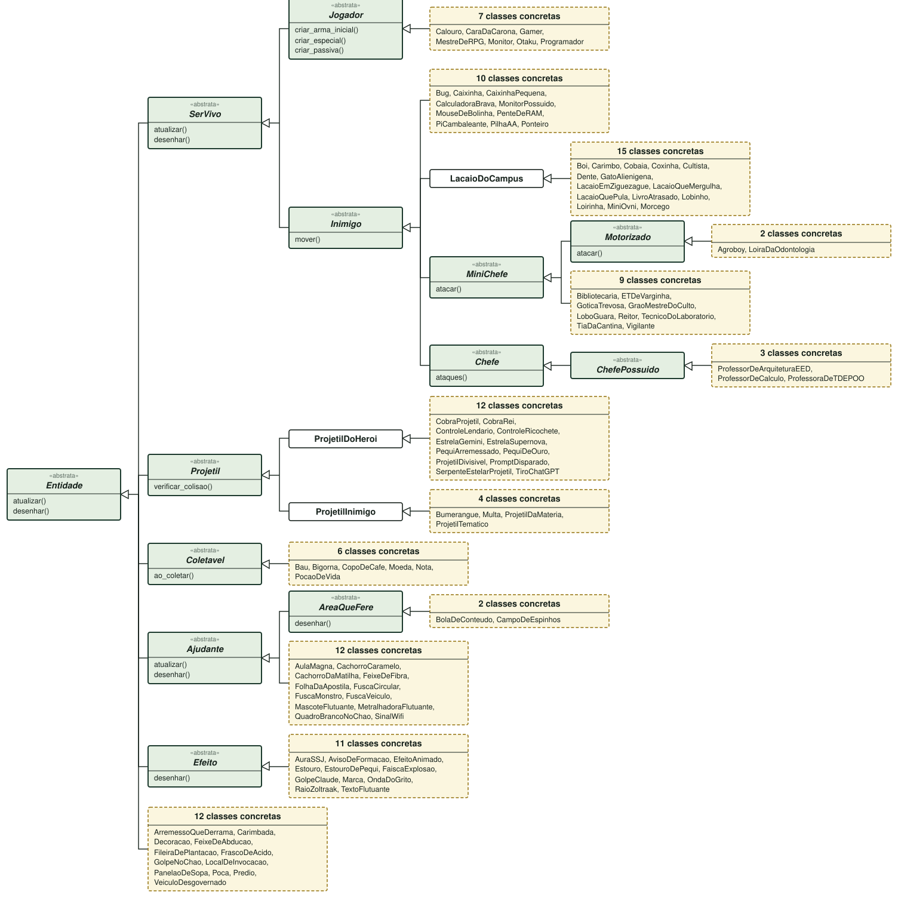
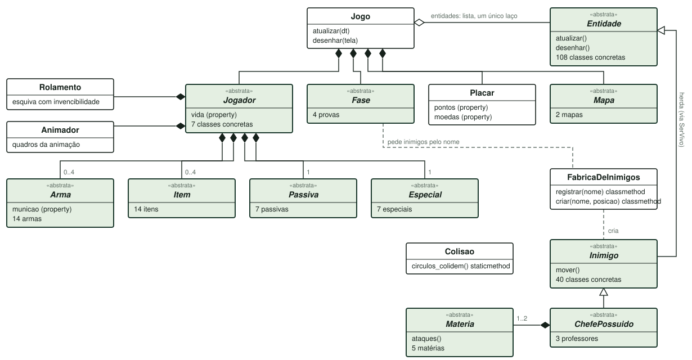

# UFJ Survivors

Sobreviva às provas do semestre na UFJ. Jogo 2D em Pygame no estilo "survivors", feito para o trabalho prático de Programação Orientada a Objetos: um semestre de 20 minutos no Campus Jatobá (mapa gerado de satélite e OpenStreetMap), personagens ilustrados e animados no estilo Disgaea, inimigos que são objetos das matérias do semestre e, com hora marcada (5, 10 e 15 minutos, com o chefe anterior vivo ou não), um professor possuído pela própria matéria como chefe. O objetivo do meio do caminho é caçar os mini-chefes do mapa. Das 15:00 em diante a dificuldade dispara até ninguém passar muito dos 20:00. Quem derrota os três chefes termina o semestre ("Fim do semestre!"); quem, além disso, chega vivo aos 20:00 termina com honras e ganha um bônus de moedas; quem não derrota os três é reprovado.

| Hora | Chefe | Fases da luta |
|---|---|---|
| 5:00 | Professor de Cálculo | Cálculo I, depois Cálculo II |
| 10:00 | Professor de Arquitetura e ED | Arquitetura de Computadores, depois Estrutura de Dados em C |
| 15:00 | Professora de TD e POO | Transformação Digital, depois Programação Orientada a Objetos |

Em cada chefe, quando a vida da primeira matéria zera, a segunda (mais difícil) possui o professor e a luta continua com a vida cheia.

**Grupo:** Filipe Duarte de Freitas Oliveira e Thaller Subtil de Carvalho.



> **Vai trabalhar no projeto (você ou sua IA)?** Leia primeiro o [AGENTS.md](AGENTS.md) e a lista de [pendências](docs/PENDENCIAS.md).

## Como rodar

Requer Python 3.12.

macOS / Linux:
```bash
python3.12 -m venv .venv
.venv/bin/pip install -r requirements.txt
.venv/bin/python main.py
```

Windows:
```bat
py -3.12 -m venv .venv
.venv\Scripts\pip install -r requirements.txt
.venv\Scripts\python main.py
```

## Controles

| Tecla | Ação |
|---|---|
| WASD ou setas | Andar (as armas atacam sozinhas) |
| Mouse | Mirar as armas de disparo e o especial |
| Clique esquerdo | Alterna entre mira no mouse e mira automática (inimigo mais próximo) |
| Espaço | Especial |
| Shift ou clique direito | Rolar: esquiva rápida, invencível enquanto dura (recarga de ~1 s) |
| Esc | Pausar |
| 1, 2, 3 ou Enter | Escolher carta ao subir de nível |
| R / B / P | Sortear as cartas de novo / banir a carta destacada pelo resto da partida (3 por partida) / pular a escolha |

## Mecânicas inspiradas no HoloCure

- **Aviso antes das formações:** setas vermelhas piscam na borda da tela por 1,2 s antes de um cerco ou de uma parede (dá para sair rolando).
- **Dano com variação de ±10%** e crítico acima de 100% de chance virando dano extra.
- **Cartas com peso:** a Cola e o que foi comprado na loja aparecem menos. **B** bane uma carta; com tudo no nível máximo (ou banido), as cartas passam a ser Lanche da Cantina (recupera 30% da vida máxima) ou Bolsa de Monitoria (50 moedas).
- **Inimigos com peso por matéria:** os lacaios de cada matéria entram perto do chefe dela e aparecem mais.
- **Bigorna:** cada mini-chefe do mapa deixa uma bigorna que afia uma arma (+15% de dano, até 3 vezes por arma).

## Eventos do semestre

- **Chefes com hora marcada:** 5:00, 10:00 e 15:00, com PERIGO! na tela 3 s antes. O relógio não para na luta: se um chefe ainda está de pé, o próximo vem mesmo assim. Na chegada de cada um, os lacaios comuns saem de campo (chefes vivos e mini-chefes ficam).
- **Greve:** às 7:30, por 30 s não chega ninguém novo, os inimigos em campo se assustam e chovem notas em volta do aluno.
- **Formações e gigantes:** um cerco ou uma parede a cada ~90 s, com aviso; três lacaios gigantes com hora marcada (3:00, 8:00 e 13:00).
- **Reta final:** das 15:00 em diante a dificuldade multiplica a cada 15 s (mais depressa depois das 18:00), com cercos a cada 45 s e um gigante por minuto. Aos 19:30 aparece "Faltam 30 s para o fim do semestre!"; depois dos 20:00 os inimigos ficam mais rápidos e o encostão passa da vida de qualquer aluno.
- **Mini-chefes do mapa (opcionais):** desde o começo da partida há um círculo de invocação de cada um pelo campus, com o rosto do mini-chefe em cima. Quem nunca foi invocado é um mistério: o círculo, o mini-mapa e a seta mostram um "?" e o nome "Mini-boss misterioso"; invocado uma vez, ele fica revelado em todas as partidas (salvo no progresso). Ficar dentro do círculo por 2,5 s invoca (sair esvazia): a partida para, ele é apresentado com ilustração própria, como os chefes, e entra andando pela borda da tela; os lacaios comuns em volta do aluno saem, como na chegada de um chefe, e enquanto ele está vivo nascem menos lacaios. O primeiro que o aluno enfrenta vem na força base, a qualquer hora; cada mini-chefe derrotado deixa o próximo mais forte (+50% da vida base por mini-chefe já vencido). Chefes e mini-chefes não são puxados, atrasados nem empurrados. Cada um guarda o seu lugar (segue o aluno só até certa distância e se recupera se ele fugir), traz os próprios lacaios, é forte para quem não tem melhorias e deixa um **baú garantido** e moedas. O tom é de piada interna:

  | Mini-chefe | Onde | Como ataca | Lacaios |
  |---|---|---|---|
  | Tia da Cantina (enorme) | RU | bandejas em leque e o panelão erguido e jogado; com metade da vida gira com a concha gigante atrás do aluno | coxinhas |
  | Lobo-Guará (mascote) | Eng. Florestal | dois botes seguidos e uivo; na lua cheia (metade da vida) some debaixo da terra e sai mordendo debaixo do aluno | lobinhos |
  | Gótica Trevosa | Convivência | vira morcegos e reaparece colada no aluno, anel de corações; com metade da vida, a boneca de vodu (só rolando na hora da agulhada escapa) | morcegos |
  | Grão-Mestre do Culto (**secreto**) | mata do canto sudeste | espiral de três braços sem parar e o ritual; ascendido (metade da vida), cinco braços e colunas de fogo no aluno | cultistas em círculo |
  | Vigilante (fantasiado de morcego) | Centro de Aulas II | mira com a lanterna e arranca; com metade da vida o bat-gancho puxa o aluno para uma voadora | morcegos |
  | Bibliotecária (caderno "Multa Note") | Biblioteca | anota no caderno e saem as multas, que tiram 8 moedas cada; com metade da vida, o "SHHH!" emperra as armas de quem está perto | livros atrasados |
  | Agroboy | lavoura das Agrárias | faz chover dinheiro e chama a caminhonete; com metade da vida, rodeio no touro: laça o aluno e o touro arranca; solta 150 moedas | bois |
  | Loira da Odontologia | Lab. Saúde | joga o cabelo e chama a turma, aperta a chave dos HB20 brancos; com metade da vida, atravessa o aluno com a broca | loirinhas |
  | Técnico do Laboratório (mutante) | Laboratórios | seringas e frascos de ácido, regenera; em fúria (40% da vida) três seringas e soco no chão | cobaias |
  | Reitor (o Reitor de verdade, gigante: cinco alunos de altura) | Reitoria | ergue e bate o carimbo (ofícios em anel), emblemas da UFJ e portarias; a cada carimbo, uma promessa para o ano que vem (CEIA, datacenter...); com metade da vida, apresenta o projeto e as placas do CEIA caem do céu | carimbos |
  | ET de Varginha | Centro de Aulas Secreto 51 | telepatia e feixes de abdução no chão; com metade da vida, o disco voador (três feixes e um raio que puxa) | gatos alienígenas e mini OVNIs |
  | Leão do PROERD (enorme e sério) | Auditório | cartilhas e certificados, placa de DIGA NÃO e rugido que paralisa de medo; com metade da vida tira o bastão de beisebol (golpe que mira, avança e bate forte) e come os malandros para recuperar vida | malandros do fundão, que fogem dele, e cães farejadores, que seguem o rastro do aluno |

  O Centro de Aulas Secreto 51 é um prédio inventado, num descampado a nordeste (`ferramentas/acrescentar_predio_secreto.py`). O culto não é anunciado e só entra no mapa quando o aluno passa perto. A tecla **M** abre o mini-mapa do campus com o aluno e o rosto de cada mini-chefe no lugar dele; clicar num rosto marca o mini-chefe, e só os marcados ganham seta na borda da tela.
- **Biomas do mapa:** gramado, mata, lavoura, terra batida e o descampado do Centro de Aulas Secreto 51 têm cada um a própria decoração de chão (`MapaUFJ.BIOMAS`). A lavoura fica em talhões retangulares em três áreas agrícolas (`MapaUFJ.LAVOURAS`), plantados com soja, milho e trigo em fileiras de pés em pé (o aluno passa por trás e pela frente), com corredores de terra, espantalhos e fardos, e sem árvores. As árvores ficam só nas manchas de verde-escuro, longe de ruas e calçadas; postes e bancos, à beira das ruas; e há faixa de pedestre onde um caminho cruza a rua. Andar na plantação e no mato fechado é mais lento (milho 60%, trigo 72%, soja 80%, mata 88% da velocidade); o rolamento não é afetado.
- **Baús:** comum (1 prêmio e poucas moedas), épico (2 prêmios, 12% de chance) e lendário (3 prêmios e muitas moedas, 2%), cada um com abertura própria. As moedas do baú têm 15% de chance de crítico (3x).
- **Sorte:** atributo do aluno que multiplica tudo que depende de chance: crítico, desvio, moeda ao matar, Carona Solidária, raridade do baú e crítico das moedas. Vem da Moeda da Sorte (item, +15% por nível), da Sorte de Calouro (loja, +5% por nível); o Jogo de Cintura (item) dá a chance de desviar de golpes.

## Centro Acadêmico

No menu principal. As moedas pegas nas provas (mais um bônus por prova aprovada e pelo tempo sobrevivido) ficam salvas em `dados/progresso.json` e são gastas na **loja** (melhorias permanentes de vida, dano, velocidade, recarga, rolamento, crítico, coleta, experiência e moedas; e desbloqueio do Pequi Explosivo, do Wi-Fi Eduroam, do Tênis de Corrida e dos Óculos de Grau) ou no **cassino** (Máquina de Salgadinho e Dado do Mestre, só com moedas do jogo). O treino não paga moedas.


**Lanches da Cantina** (aba LANCHES da loja): um por vez, valem só para a próxima partida (fora do treino): Pão de Queijo (+20 de vida máxima), Coxinha (+15% de experiência), Caldo de Cana (armas 10% mais rápidas), Açaí (+10% de velocidade), Pastel de Feira (+10% de dano).

**Cassino:** além da Máquina de Salgadinho e do Dado do Mestre, a **Roleta do Bandejão** (o aluno pede um prato e ganha se a roda parar nele: arroz 2,2x, frango 2,8x, bife 5,5x, strogonoff 11x).

**Conquistas** (botão CONQUISTAS): 10 metas que pagam moedas uma vez só, conferidas no fim de cada partida: passar em Cálculo, semestre aprovado, combo 67, mil eliminações, nível 40, fazer uma colab, ser pego colando, chegar ao fim de uma greve, afiar a mesma arma 3 vezes e jogar com todas as classes.
## Classes

| Classe | Arma inicial (exclusiva) | Habilidades (nas cartas de nível, 3 níveis cada) | Especial |
|---|---|---|---|
| Otaku | Lightstick | **Instinto Otaku**: 8% de chance de acerto crítico (dano em dobro).; **Armadura de Roteiro**: O golpe que te derrubaria deixa 1 de vida e 2 s de invencibilidade. Volta em 90 s.; **Poder da Amizade**: +5% de dano por amigo em campo (Caramelo, Fusca, mascotes, possuídos), até +50%. | **Super Saiyajin**: Cabelo dourado: dano em dobro e mais velocidade. A cada uso sobe de nível (SSJ2, SSJ3). |
| Programador | Teclado Mecânico | **Laço de Repetição**: Cada disparo tem 10% de chance de repetir na hora.; **Cafeinado**: Armas recarregam 1,6% mais rápido por nível do aluno; a garrafa da Virada leva +20 doses.; **Compilar**: Andando, acumula linhas de código; parado 1 s, compila: um pulso com o dano acumulado. | **Virada de Noite**: Enche a garrafa com 100 doses de café; segurando Espaço, cada dose é um tiro de código na mira. |
| Mestre de RPG | Dado de 20 Lados | **Rolagem de Iniciativa**: O especial recarrega 15% mais rápido.; **Ficha de Personagem**: A cada 15 s, +30% num atributo sorteado por 15 s (FOR, DES, CON, INT, SAB ou CAR).; **Teste de Resistência**: Ao levar um golpe, rola um d20: com 18 ou mais, o golpe não entra. | **Zoltraak**: Um raio mágico enorme na direção da mira, que atravessa tudo. O dano é rolado em 8d6. |
| Monitor | Caneta de Correção | **Plantão de Dúvidas**: Recupera 0,4 de vida por segundo e puxa as notas 20% mais de longe.; **Gabarito**: 10% de chance de marcar o inimigo com um X: ele leva 25% a mais de dano e pode curar ao morrer.; **Horário de Atendimento**: Parado por 1 s: os inimigos em volta ficam 20% mais lentos e você cura 2% da vida a cada 2 s. | **Revisão para Prova**: Puxa todas as notas do campus, recupera 30% da vida e abre por 10 s uma zona onde nada te fere. |
| Gamer | Controle | **Reflexo**: O rolamento recarrega 15% mais rápido.; **Frame Perfect**: Rolar no último instante antes de um golpe: câmera lenta por 1 s e +30% de dano por 8 s.; **Combo**: 50 acertos sem levar dano: +20% de velocidade e 20% de chance de golpe duplo por 10 s. | **Tela Azul**: O jogo dos inimigos trava: os da tela ficam parados por 4 s e os projéteis deles somem. |
| Calouro | Mapa do Campus | **Sede de Aprender**: +15% de experiência.; **Veterano Camarada**: Um veterano anda com você e usa a sua arma inicial com 50% da força.; **Perdido no Campus**: +3% de velocidade por inimigo perto (até +80%) e +25% de experiência de quem morre perto. | **Calourada**: Festa! 40% dos inimigos em volta viram seus aliados por 8 s; os outros batem 30% mais fraco. |
| Cara da Carona | Fusca Azul | **Carona Solidária**: Inimigo que morre possuído (atropelado) tem 12% de chance de deixar uma moeda.; **Buzina**: A cada 10 s, uma buzinada em volta: dano (mais forte no centro) e atordoa por um instante.; **Carro Lotado**: +3% de dano por passageiro (inimigo possuído) em campo, até +60%. | **Lotação**: Quatro fuscas lotados cruzam a tela atropelando e possuindo inimigos. |

O aluno começa sem nenhuma habilidade: elas aparecem nas cartas de nível junto com armas e itens. O Programador é quem tem a munição do jogo: a Virada de Noite enche a garrafa de café e, segurando Espaço, cada dose é um tiro; os copos de café que os inimigos soltam enchem a garrafa (para as outras classes, adiantam o especial). O Super Saiyajin sobe de nível a cada uso; o Calouro avança de período a cada 10 níveis.

As quatro últimas ainda usam a arte do Programador ou do Otaku (provisória). Na tela de escolha, as classes aparecem num carrossel.

**Cola:** item que só aparece nas cartas ao subir de nível (nunca no baú). Nível 1: 1,5x de experiência e -15% de vida máxima; nível 2: 2x e -20%. A cada nível que o aluno sobe há uma chance pequena (2% e 3%) de ser pego colando: a cola é confiscada e as notas rendem só 0,5x pelos 2 níveis seguintes. Com o chefe em campo a chance dobra (o professor está olhando); o Óculos de Grau esconde melhor a cola.

**Convite da Atlética:** a cada 12 s (10 e 8 nos níveis seguintes) solta um grito de guerra que fere e empurra os inimigos em volta. **Pendrive:** o especial guarda 2 cargas (3 no nível máximo) e recarrega mais rápido. **Apostila** (arma): 1 a 3 folhas giram em volta do aluno por alguns segundos, somem e voltam.

O aluno carrega no máximo **4 armas e 4 itens**. Com as vagas cheias, as cartas só oferecem melhorias do que ele já tem. Uma colab funde duas armas no nível máximo numa só e libera uma vaga para uma arma nova. A arma inicial é exclusiva da classe: não aparece nas cartas das outras classes e não entra em colab. As armas comuns são Caramelo, Cobra Python, Quadro Branco, Apostila, Mascote do ChatGPT, Mascote do Claude, Gemini, Pequi Explosivo, Wi-Fi Eduroam, Régua de 1 Metro e Corrente de WhatsApp; as colabs são Serpente Estelar (Cobra + Gemini), Metralhadora de Prompts (ChatGPT + Claude), Fake News (Corrente + ChatGPT), Aula Expositiva (Apostila + Quadro Branco), Caramelo 5G (Caramelo + Wi-Fi) e Catapulta do Cerrado (Régua + Pequi).

## Personalização do aluno

Ao clicar em JOGAR (ou escolher o professor no treino), vem a tela de **matrícula**, na secretaria: escolhe-se a classe, cada uma com aparência própria e fixa (o retrato grande na webcam e o boneco como aparece na partida), e a carteirinha sai impressa.

## Modo treino

No título, **TREINO** abre um menu para escolher qual professor enfrentar (Cálculo I; Arquitetura e ED em C; TD e POO). Na mesma tela, **C** liga "começar direto no chefe" (a prova começa 3 segundos antes dele chegar) e **I** deixa o aluno imortal. Partidas de treino não entram no ranking. Serve para testar e balancear cada chefe sem jogar o semestre inteiro.

## Testes

```bash
.venv/bin/pytest
```

Para simular uma partida inteira sem janela (útil para balancear):
```bash
.venv/bin/python ferramentas/simular_partida.py --heroi 1 --imortal
```

## Ferramentas de arte

```bash
.venv/bin/python ferramentas/gerar_mapa.py        # mapa do Campus Jatobá (baixa satélite e OpenStreetMap se faltar)
.venv/bin/python ferramentas/montar_sprites.py    # folhas de animação -> pixel art (precisa das folhas em arte_bruta/)
.venv/bin/python ferramentas/gerar_sons.py        # efeitos sonoros
```

## Onde está cada requisito de POO

| Requisito | Arquivo | Classe / método |
|---|---|---|
| Classe abstrata com `atualizar()` e `desenhar()` | `jogo/nucleo/entidade.py` | `Entidade` |
| 3+ inimigos herdando de uma base | `jogo/inimigos/` | `Inimigo` e `Bug`, `CalculadoraBrava`, `MouseDeBolinha`, `Caixinha`, `PiCambaleante`, `Ponteiro`, `PilhaAA`, `PenteDeRAM`; chefes: `Chefe` > `ChefePossuido` > `ProfessorDeCalculo`, `ProfessorDeArquiteturaEED`, `ProfessoraDeTDEPOO`; matérias: `Materia` > `CalculoI`, `CalculoII`, `ArquiteturaDeComputadores`, `EstruturaDeDadosEmC`, `TransformacaoDigital`, `ProgramacaoOrientadaAObjetos` |
| Polimorfismo num único laço, sem `if` por tipo | `jogo/jogo.py` | `Jogo.atualizar()` |
| Encapsulamento com `@property` e validação | `jogo/nucleo/ser_vivo.py`, `jogo/placar.py`, `jogo/jogador/garrafa_de_cafe.py` | `SerVivo.vida`, `Placar.pontos`, `GarrafaDeCafe.municao` (as doses de café da Virada de Noite) |
| Composição | `jogo/jogo.py`, `jogo/jogador/jogador.py` | `Jogo` contém `Jogador`, `Fase` (o `Semestre`, com o calendário das três provas), `Placar`; `Jogador` contém `Arma`, `Item`, `Habilidade`, `Especial` (a `ViradaDeNoite` contém a `GarrafaDeCafe`); `ChefePossuido` contém suas `Materia` |
| Métodos especiais | `jogo/ranking.py` | `RegistroRanking.__lt__`, `__eq__`, `__str__` |
| `@classmethod` e `@staticmethod` | `jogo/inimigos/fabrica.py`, `jogo/nucleo/colisao.py` | `FabricaDeInimigos.criar()`, `Colisao.circulos_colidem()` |





Entregas: [etapa 1, proposta](docs/entregas/etapa1_proposta.md); etapa 2, protótipo na tag `etapa-2-prototipo`; [etapa 3, hierarquia completa e polimorfismo](docs/entregas/etapa3_hierarquia_e_polimorfismo.html) (página HTML autocontida: baixe o arquivo e abra no navegador; ela é gerada por `ferramentas/gerar_entrega.py`).

## Estrutura

```
main.py            ponto de entrada
jogo/
  nucleo/          Entidade, SerVivo, Colisao, Animacao/Animador, câmera, grade espacial, arte e som
  jogador/         Jogador, as classes, Habilidade e as 21 habilidades, especiais, a Garrafa de Café, bônus temporários
  inimigos/        Inimigo, fábrica, um arquivo por inimigo, Chefe, ChefePossuido e os três chefes
    materias/      Materia e uma matéria por arquivo (os ataques de cada chefe)
  armas/           Arma e suas famílias, uma arma por arquivo, colabs
  itens/           itens passivos
  projeteis/  ajudantes/  coletaveis/
  cenas/           telas (título, seleção, partida, nível, baú, pausa, fim, ranking) e HUD
  jogo.py fase.py placar.py ranking.py progressao.py efeitos.py
  mapa.py cenario.py  Mapa (abstrata), MapaUFJ, Predio, Decoracao e o pátio genérico
assets/            sprites, ícones, cenário, sons, fontes e a arte reaproveitada (legado/)
ferramentas/       preparo da arte, geração dos sons, simulador de partida
testes/            testes automáticos (pytest)
docs/              entregas, diagrama, registro de uso de IA e guia do código
```

## Como criar um inimigo novo

Basta um arquivo novo em `jogo/inimigos/`. Nenhuma classe existente muda:

```python
# jogo/inimigos/cafe_frio.py
from jogo.inimigos.fabrica import FabricaDeInimigos
from jogo.inimigos.inimigo import Inimigo


@FabricaDeInimigos.registrar("cafe_frio")
class CafeFrio(Inimigo):
    NOME = "Café Frio"
    IMAGEM = "sprites/cafe.png"
    VIDA = 15
    VELOCIDADE = 60

    def mover(self, dt, jogo):
        self.ir_em_direcao(jogo.jogador.posicao, dt)
```

Para ele aparecer, acrescente `(tempo_em_segundos, "cafe_frio")` em `APRESENTACOES` do `Semestre` (`jogo/fase.py`).

## Como criar uma matéria (ou um chefe) novo

Uma matéria é uma classe que herda de `Materia` e diz quais ataques usa; os ataques prontos (`leque`, `anel`, `rajada`, `chamada`, `chefe.investir`) já existem:

```python
# jogo/inimigos/materias/banco_de_dados.py
from jogo.inimigos.materias.materia import Materia


class BancoDeDados(Materia):
    NOME = "Banco de Dados"
    COR = (255, 220, 90)
    SIMBOLO = "SQL"
    VIDA = 2500
    LACAIOS = ("caixinha", "bug")

    def ataques(self):
        return [self.select, self.join]

    def select(self, chefe, jogo):
        self.leque(chefe, jogo, 9)

    def join(self, chefe, jogo):
        self.anel(chefe, jogo, 12, simbolo="JOIN")
```

Para virar chefe, um arquivo em `jogo/inimigos/` com uma classe que herda de `ChefePossuido`, registrada na fábrica e com `MATERIAS = (BancoDeDados,)`. Nenhuma classe existente muda.

## Créditos

Veja [assets/CREDITOS.md](assets/CREDITOS.md). A arte em `assets/legado/` foi reaproveitada do jogo "Crônicas do Saber" (Fiuphis/Rpggame).
