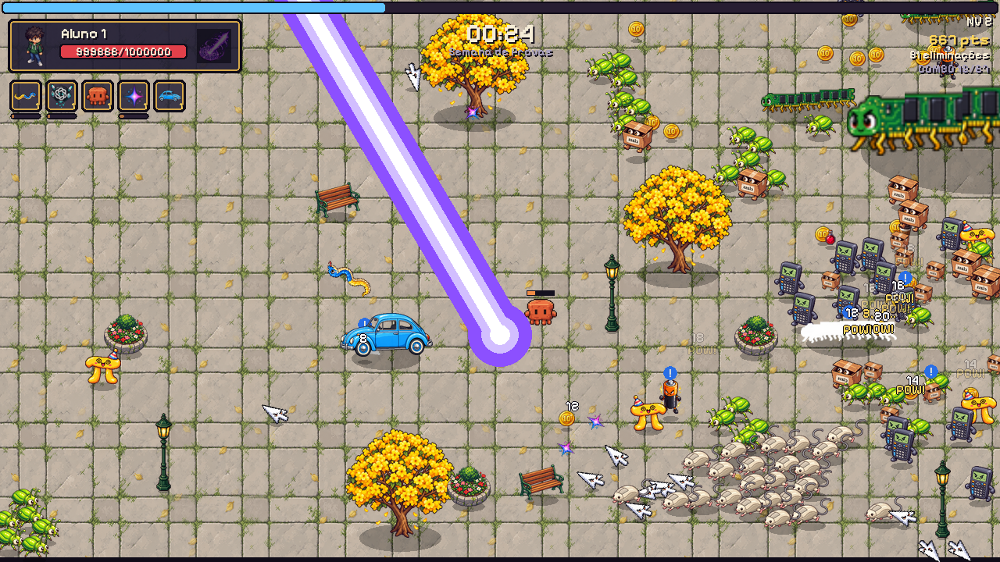

# UFJ Survivors

Sobreviva às provas do semestre na UFJ. Jogo 2D em Pygame no estilo "survivors", feito para o trabalho prático de Programação Orientada a Objetos: três provas de 5 minutos no Campus Jatobá (mapa gerado de satélite e OpenStreetMap), personagens ilustrados e animados no estilo Disgaea, inimigos que são objetos das matérias do semestre e, no fim de cada prova, um professor possuído pela própria matéria como chefe.

| Prova | Chefe | Fases da luta |
|---|---|---|
| 1ª | Professor de Cálculo | Cálculo I |
| 2ª | Professor de Arquitetura e ED | Arquitetura de Computadores, depois Estrutura de Dados em C |
| 3ª | Professora de TD e POO | Transformação Digital, depois Programação Orientada a Objetos |

No chefe de duas matérias, quando a vida da primeira zera, a segunda (mais difícil) possui o professor e a luta continua com a vida cheia.

**Grupo:** Filipe Duarte de Freitas Oliveira, Gabriel Gomes Borges, Gustavo do Nascimento Silva e Thaller Subtil de Carvalho.



> **Vai trabalhar no projeto (você ou sua IA)?** Leia primeiro o [AGENTS.md](AGENTS.md) e a lista de [pendências](docs/PENDENCIAS.md).

## Como rodar

Requer Python 3.12.

macOS / Linux:
```bash
python3.12 -m venv .venv
.venv/bin/pip install -r requirements.txt
.venv/bin/python main.py
```

Windows:
```bat
py -3.12 -m venv .venv
.venv\Scripts\pip install -r requirements.txt
.venv\Scripts\python main.py
```

## Controles

| Tecla | Ação |
|---|---|
| WASD ou setas | Andar (as armas atacam sozinhas) |
| Mouse | Mirar as armas de disparo e o especial |
| Clique esquerdo | Alterna entre mira no mouse e mira automática (inimigo mais próximo) |
| Espaço | Especial |
| Shift ou clique direito | Rolar: esquiva rápida, invencível enquanto dura (recarga de ~1 s) |
| Esc | Pausar |
| 1, 2, 3 ou Enter | Escolher carta ao subir de nível |
| R / B / P | Sortear as cartas de novo / banir a carta destacada pelo resto da partida (3 por partida) / pular a escolha |

## Mecânicas inspiradas no HoloCure

- **Aviso antes das formações:** setas vermelhas piscam na borda da tela por 1,2 s antes de um cerco ou de uma parede (dá para sair rolando).
- **Dano com variação de ±10%** e crítico acima de 100% de chance virando dano extra.
- **Cartas com peso:** a Cola e o que foi comprado na loja aparecem menos. **B** bane uma carta; sem nada para oferecer, aparecem cartas de atributo (Estudo Extra, Café Reforçado, Fôlego, Lanche da Cantina).
- **Inimigos com peso por prova:** os da matéria de cada prova aparecem mais.
- **Moedas por prova:** a 2ª paga 1,2x e a 3ª 1,4x.
- **Bigorna:** o Monitor Possuído deixa uma bigorna que afia uma arma (+15% de dano, até 3 vezes por arma).

## Eventos das provas

- **Greve:** uma vez por prova (3:20 na 1ª, 3:30 na 2ª, 2:45 na 3ª), por 30 s não chega ninguém novo, os inimigos em campo se assustam e chovem notas em volta do aluno.
- **Monitor Possuído:** mini-chefe da 2ª e da 3ª prova. Persegue o aluno e arremessa listas de exercícios (três de cada vez); ao morrer solta baú e moedas. Usa a arte do aluno tingida de roxo até ter arte própria.

## Centro Acadêmico

No menu principal. As moedas pegas nas provas (mais um bônus por prova aprovada e pelo tempo sobrevivido) ficam salvas em `dados/progresso.json` e são gastas na **loja** (melhorias permanentes de vida, dano, velocidade, recarga, rolamento, crítico, coleta, experiência e moedas; e desbloqueio do Pequi Explosivo, do Wi-Fi Eduroam, do Tênis de Corrida e dos Óculos de Grau) ou no **cassino** (Máquina de Salgadinho e Dado do Mestre, só com moedas do jogo). O treino não paga moedas.


**Lanches da Cantina** (aba LANCHES da loja): um por vez, valem só para a próxima partida (fora do treino): Pão de Queijo (+20 de vida máxima), Coxinha (+15% de experiência), Café Coado (armas 10% mais rápidas), Açaí (+10% de velocidade), Pastel de Feira (+10% de dano).

**Cassino:** além da Máquina de Salgadinho e do Dado do Mestre, a **Roleta do Bandejão** (strogonoff 3x, bife 2x, frango 1,5x, salada 0,5x; o resto não paga).

**Conquistas** (botão CONQUISTAS): 10 metas que pagam moedas uma vez só, conferidas no fim de cada partida: passar em Cálculo, semestre aprovado, combo 67, mil eliminações, nível 40, fazer uma colab, ser pego colando, chegar ao fim de uma greve, afiar a mesma arma 3 vezes e jogar com todas as classes.
## Classes

| Classe | Ativa (arma inicial) | Passiva | Especial |
|---|---|---|---|
| Otaku | Caramelo | Instinto Otaku: chance de crítico (dano em dobro) que cresce a cada nível | Super Saiyajin |
| Programador | Cobra Python | Cafeinado: armas recarregam 1% mais rápido por nível e o café rende mais | Virada de Noite: café cheio e armas 2,5x mais rápidas por 8 s |
| Mestre de RPG | Gemini | Rolagem de Iniciativa: o especial recarrega 2% mais rápido por nível | Zoltraak |
| Monitor | Quadro Branco: área no chão que atrasa e fere | Plantão de Dúvidas: regenera vida e puxa notas de mais longe, crescendo por nível | Revisão para Prova: puxa todas as notas e cura 30% |
| Gamer | Controle: ricocheteia entre inimigos | Reflexo: rolamento recarrega mais rápido, crescendo por nível | Speedrun: 6 s de velocidade alta e invencibilidade |
| Calouro | Apostila | Sede de Aprender: +10% de experiência e +1% por nível | Trote Reverso: inimigos em volta levam dano e fogem por 5 s |
| Cara da Carona | Fusca Azul | Carona Solidária: quem morre possuído pode deixar moeda | Lotação: 4 fuscas cruzam a tela |

As quatro últimas ainda usam a arte do Programador ou do Otaku (provisória). Na tela de escolha, as classes aparecem num carrossel.

**Cola:** item que só aparece nas cartas ao subir de nível (nunca no baú). Nível 1: 1,5x de experiência e -15% de vida máxima; nível 2: 2x e -20%. A cada nível que o aluno sobe há uma chance pequena (2% e 3%) de ser pego colando: a cola é confiscada e as notas rendem só 0,5x pelos 2 níveis seguintes. Com o chefe em campo a chance dobra (o professor está olhando); o Óculos de Grau esconde melhor a cola.

**Convite da Atlética:** a cada 12 s (10 e 8 nos níveis seguintes) solta um grito de guerra que fere e empurra os inimigos em volta. **Pendrive:** o especial guarda 2 cargas (3 no nível máximo) e recarrega mais rápido. **Apostila** (arma): 1 a 3 folhas giram em volta do aluno por alguns segundos, somem e voltam.

O aluno carrega no máximo **4 armas e 4 itens**. Com as vagas cheias, as cartas só oferecem melhorias do que ele já tem. Uma colab funde duas armas no nível máximo numa só e libera uma vaga para uma arma nova.

## Personalização do aluno

Ao clicar em JOGAR (ou escolher o professor no treino), a tela **MONTE SEU ALUNO** vem primeiro: escolhe o gênero (aluno ou aluna) e troca o tom de pele, a cor do cabelo, do moletom e da calça (setas para escolher e trocar, R sorteia as cores, P ou Backspace volta as cores ao padrão sem mudar o gênero, Enter vai para a escolha de classe). Na escolha de classe, cada cartão mostra o aluno montado, caracterizado para aquela classe (a aluna tem arte própria: `aluna1` para Programador e Mestre de RPG, `aluna2` para o Otaku; a aluna Otaku tem também o próprio Super Saiyajin, `aluna2_ssj`; se faltar a arte feminina de alguma classe, usa a masculina). A arte não muda: `Aparencia` (`jogo/jogador/aparencia.py`) separa as partes do sprite (cada parte é a região conectada da sua cor que nasce no lugar certo do corpo, para olhos e bochecha não pegarem a cor do cabelo ou do moletom) e aplica o novo tom mantendo o sombreado. A última escolha fica lembrada para a próxima partida. No Super Saiyajin o cabelo continua dourado.

## Modo treino

No título, **TREINO** abre um menu para escolher qual professor enfrentar (Cálculo I; Arquitetura e ED em C; TD e POO). Na mesma tela, **C** liga "começar direto no chefe" (a prova começa 3 segundos antes dele chegar) e **I** deixa o aluno imortal. Partidas de treino não entram no ranking. Serve para testar e balancear cada chefe sem jogar o semestre inteiro.

## Testes

```bash
.venv/bin/pytest
```

Para simular uma partida inteira sem janela (útil para balancear):
```bash
.venv/bin/python ferramentas/simular_partida.py --heroi 1 --imortal
```

## Ferramentas de arte

```bash
.venv/bin/python ferramentas/gerar_mapa.py        # mapa do Campus Jatobá (baixa satélite e OpenStreetMap se faltar)
.venv/bin/python ferramentas/montar_sprites.py    # folhas de animação -> pixel art (precisa das folhas em arte_bruta/)
.venv/bin/python ferramentas/endurecer_sprite.py ORIGEM DESTINO   # arte "lisa" no tamanho do jogo -> contorno e paleta de pixel art
.venv/bin/python ferramentas/gerar_sons.py        # efeitos sonoros
```

## Onde está cada requisito de POO

| Requisito | Arquivo | Classe / método |
|---|---|---|
| Classe abstrata com `atualizar()` e `desenhar()` | `jogo/nucleo/entidade.py` | `Entidade` |
| 3+ inimigos herdando de uma base | `jogo/inimigos/` | `Inimigo` e `Bug`, `CalculadoraBrava`, `MouseDeBolinha`, `Caixinha`, `PiCambaleante`, `Ponteiro`, `PilhaAA`, `PenteDeRAM`; chefes: `Chefe` > `ChefePossuido` > `ProfessorDeCalculo`, `ProfessorDeArquiteturaEED`, `ProfessoraDeTDEPOO`; matérias: `Materia` > `CalculoI`, `ArquiteturaDeComputadores`, `EstruturaDeDadosEmC`, `TransformacaoDigital`, `ProgramacaoOrientadaAObjetos` |
| Polimorfismo num único laço, sem `if` por tipo | `jogo/jogo.py` | `Jogo.atualizar()` |
| Encapsulamento com `@property` e validação | `jogo/nucleo/ser_vivo.py`, `jogo/placar.py`, `jogo/armas/arma.py` | `SerVivo.vida`, `Placar.pontos`, `ArmaDeDisparo.municao` |
| Composição | `jogo/jogo.py`, `jogo/jogador/jogador.py` | `Jogo` contém `Jogador`, `Fase` (a lista das três provas), `Placar`; `Jogador` contém `Arma`, `Item`, `Passiva`, `Especial`; `ChefePossuido` contém suas `Materia` |
| Métodos especiais | `jogo/ranking.py` | `RegistroRanking.__lt__`, `__eq__`, `__str__` |
| `@classmethod` e `@staticmethod` | `jogo/inimigos/fabrica.py`, `jogo/nucleo/colisao.py` | `FabricaDeInimigos.criar()`, `Colisao.circulos_colidem()` |

Diagrama de classes: [docs/entregas/diagrama_classes.png](docs/entregas/diagrama_classes.png). Proposta completa: [docs/entregas/etapa1_proposta.md](docs/entregas/etapa1_proposta.md).

## Estrutura

```
main.py            ponto de entrada
jogo/
  nucleo/          Entidade, SerVivo, Colisao, Animacao/Animador, câmera, grade espacial, arte e som
  jogador/         Jogador, as classes e suas passivas, especiais, bônus temporários, Aparencia
  inimigos/        Inimigo, fábrica, um arquivo por inimigo, Chefe, ChefePossuido e os três chefes
    materias/      Materia e uma matéria por arquivo (os ataques de cada chefe)
  armas/           Arma e suas famílias, uma arma por arquivo, colabs
  itens/           itens passivos
  projeteis/  ajudantes/  coletaveis/
  cenas/           telas (título, seleção, partida, nível, baú, pausa, fim, ranking) e HUD
  jogo.py fase.py placar.py ranking.py progressao.py efeitos.py
  mapa.py cenario.py  Mapa (abstrata), MapaUFJ, Predio, Decoracao e o pátio genérico
assets/            sprites, ícones, cenário, sons, fontes e a arte reaproveitada (legado/)
ferramentas/       preparo da arte, geração dos sons, simulador de partida
testes/            testes automáticos (pytest)
docs/              entregas, diagrama, registro de uso de IA, especificação e plano
```

## Como criar um inimigo novo

Basta um arquivo novo em `jogo/inimigos/`. Nenhuma classe existente muda:

```python
# jogo/inimigos/cafe_frio.py
from jogo.inimigos.fabrica import FabricaDeInimigos
from jogo.inimigos.inimigo import Inimigo


@FabricaDeInimigos.registrar("cafe_frio")
class CafeFrio(Inimigo):
    NOME = "Café Frio"
    IMAGEM = "sprites/cafe.png"
    VIDA = 15
    VELOCIDADE = 60

    def mover(self, dt, jogo):
        self.ir_em_direcao(jogo.jogador.posicao, dt)
```

Para ele aparecer, acrescente `(tempo_em_segundos, "cafe_frio")` em `APRESENTACOES` de uma das provas (`ProvaDeCalculo`, `ProvaDeArquiteturaEED` ou `ProvaDeTDEPOO`, em `jogo/fase.py`).

## Como criar uma matéria (ou um chefe) novo

Uma matéria é uma classe que herda de `Materia` e diz quais ataques usa; os ataques prontos (`leque`, `anel`, `rajada`, `chamada`, `chefe.investir`) já existem:

```python
# jogo/inimigos/materias/banco_de_dados.py
from jogo.inimigos.materias.materia import Materia


class BancoDeDados(Materia):
    NOME = "Banco de Dados"
    COR = (255, 220, 90)
    SIMBOLO = "SQL"
    VIDA = 2500
    LACAIOS = ("caixinha", "bug")

    def ataques(self):
        return [self.select, self.join]

    def select(self, chefe, jogo):
        self.leque(chefe, jogo, 9)

    def join(self, chefe, jogo):
        self.anel(chefe, jogo, 12, simbolo="JOIN")
```

Para virar chefe, um arquivo em `jogo/inimigos/` com uma classe que herda de `ChefePossuido`, registrada na fábrica e com `MATERIAS = (BancoDeDados,)`. Nenhuma classe existente muda.

## Créditos

Veja [assets/CREDITOS.md](assets/CREDITOS.md). A arte em `assets/legado/` foi reaproveitada do jogo "Crônicas do Saber" (Fiuphis/Rpggame).
