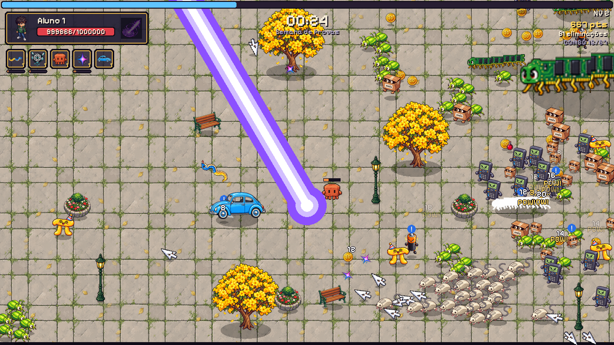
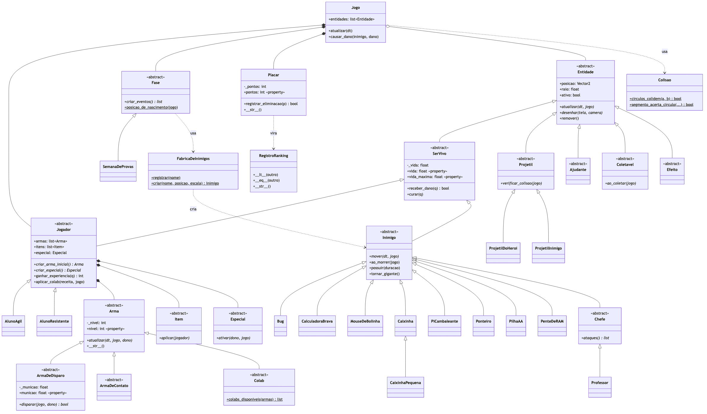

# Etapa 1: proposta do jogo e diagrama de classes

**Disciplina:** Programação Orientada a Objetos, UFJ. **Professora:** Emília Alves Nogueira.

**Integrantes:**

**Repositório:** https://github.com/thallersubtil/ufj-survivors

## 1. O jogo

**UFJ Survivors** é um jogo 2D em Pygame no estilo "survivors" (Vampire Survivors, HoloCure). O jogador controla um aluno da UFJ que precisa sobreviver à **Semana de Provas**: 15 minutos de ondas cada vez maiores de lacaios das matérias do semestre, objetos do dia a dia que ganharam vida, até a chegada do chefe final, o **Professor**.

O herói só anda; as armas atacam sozinhas. Os inimigos derrotados soltam **notas** (fichinhas de "10") que dão experiência. A cada nível o jogo pausa e oferece três cartas: uma arma nova, a melhoria de uma arma ou um item passivo. As armas misturam memes, IAs e anime: cachorro caramelo, cobra do Python, mascotes do ChatGPT e do Claude, a estrela do Gemini, o fusca azul, o Zoltraak da Frieren e o Super Saiyajin.

Regras principais:
- **Duração:** 15 minutos. Um lacaio novo aparece a cada 1,5 minuto; mini-chefes aos 5 e aos 10 minutos (soltam um baú); o Professor aos 15.
- **Vitória:** derrotar o Professor ("APROVADO!"). **Derrota:** a vida do herói chegar a zero ("REPROVADO!").
- **Café é a munição:** as armas de disparo gastam café, que recarrega sozinho; sem café elas atiram bem mais devagar. Copinhos de café caídos enchem o estoque.
- **Combo 67:** 67 eliminações seguidas sem levar dano tocam o áudio "six seven" e dão +50% de velocidade por 6 segundos.
- **Colabs:** duas armas no nível máximo se juntam numa arma nova (por exemplo, Caramelo + Fusca Azul = Caramelo no Fusca).
- **Ranking:** os 10 melhores resultados ficam salvos em um arquivo local.

## 2. Controles

| Tecla | Ação |
|---|---|
| WASD ou setas | Andar |
| Espaço | Especial (Zoltraak ou Super Saiyajin) |
| Esc | Pausar |
| 1, 2, 3 ou Enter | Escolher carta ao subir de nível |
| R / P | Sortear as cartas de novo / pular a escolha (+20 de vida) |

## 3. Heróis

| | Aluno 1 (ágil) | Aluno 2 (resistente) |
|---|---|---|
| Vida / velocidade | 80 / 230 | 130 / 180 |
| Arma inicial | Cobra Python | Caramelo |
| Especial | Zoltraak: raio mágico que atravessa tudo | Super Saiyajin: 10 s de dano em dobro e mais velocidade |

## 4. Inimigos

| Inimigo | Matéria | Aparência | Comportamento |
|---|---|---|---|
| Bug | POO | Besourinho verde-limão de olhos esbugalhados | Rápido e fraco; vem em bando de 6 |
| Calculadora Brava | Cálculo | Calculadora científica emburrada | Persegue sem parar |
| Mouse de Bolinha | Arquitetura | Mouse bege com o fio como rabo de rato | Para, mira e dispara em linha reta |
| Caixinha | POO | Caixa de papelão com etiqueta "class" | Anda aos pulos; ao morrer solta duas caixinhas menores |
| Pi Cambaleante | Cálculo | Letra π gorducha de chapéu de festa | Zigue-zague; ao morrer mostra "3,14..." |
| Ponteiro | Estrutura de Dados I | Setinha do mouse brava | Mergulha em linha reta, passa do ponto e mira de novo |
| Pilha AA | Estrutura de Dados I | Pilha laranja e preta, brava | Anda aos saltos; explode em faíscas ao morrer |
| Pente de RAM | Arquitetura | Pente de memória com patas douradas | Lento e resistente, ondula como centopeia |
| Professor (chefe) | Todas | Professor de óculos, barba e pilha de provas | Joga folhas de prova em leque, dá investidas e chama lacaios |

## 5. Armas, itens e especiais

- **Armas:** Cobra Python, Caramelo, Mascote do ChatGPT (às vezes "alucina" e atira para qualquer lado com dano dobrado), Mascote do Claude (pensa e acerta um golpe forte), Gemini (estrela que se divide em duas), Fusca Azul (quem é atropelado sai socando os outros inimigos). Todas vão do nível 1 ao 7.
- **Colabs:** Caramelo no Fusca, Cobras Gêmeas, Debate das IAs.
- **Itens passivos (nível 1 a 3):** Caderno de Resumos (dano), Energético (velocidade), Marmita do RU (regeneração), Mochila Pesada (vida máxima), Fone de Ouvido (alcance de coleta), Relógio de Pulso (recarga), Garrafa Térmica (café).
- **Especiais:** Zoltraak e Super Saiyajin.

## 6. Diagrama de classes

Fonte editável: `docs/diagrama_classes.mmd` (Mermaid).

Principais decisões de design:
- **`Entidade` é abstrata** e define `atualizar()` e `desenhar()`. Tudo que existe na arena herda dela: heróis, inimigos, projéteis, ajudantes (cachorro, fusca, mascotes), coletáveis e efeitos. Por isso o `Jogo` atualiza tudo num único laço sem saber o tipo de cada coisa.
- **`SerVivo`** concentra a vida (com `@property` e validação) e é a base comum de `Jogador` e `Inimigo`, que têm vida mas se comportam de jeitos diferentes.
- **`Inimigo` é abstrata** com o método abstrato `mover()`. Cada lacaio só implementa o próprio jeito de andar e, quando precisa, sobrescreve `ao_morrer()` (a Caixinha se divide, a Pilha explode, o Pi mostra "3,14..."). O `Chefe` é um inimigo com uma lista de ataques; o `Professor` é um chefe.
- **Composição:** o `Jogo` contém o `Jogador`, a `Fase` e o `Placar`. O `Jogador` contém suas `Arma`s, seus `Item`s e um `Especial`. As armas não são entidades: elas criam entidades (projéteis e ajudantes) na arena.
- **`Arma`** tem duas famílias: `ArmaDeDisparo` (com munição de café) e `ArmaDeContato`. `Colab` é uma arma criada a partir de duas outras.
- **`FabricaDeInimigos`** cria qualquer inimigo pelo nome (`@classmethod`). Cada classe de inimigo se registra com um decorador; criar um inimigo novo exige só um arquivo novo, sem alterar nenhuma classe existente.
- **`Colisao`** reúne testes de colisão como `@staticmethod` (círculo com círculo, segmento com círculo).

As classes concretas de armas, itens, projéteis e ajudantes ficam fora do diagrama para ele caber numa página. São elas: `CobraPython`, `Caramelo`, `MascoteChatGPT`, `MascoteClaude`, `Gemini`, `FuscaAzul`, `CarameloNoFusca`, `CobrasGemeas`, `DebateDasIAs`; `CadernoDeResumos`, `Energetico`, `MarmitaDoRU`, `MochilaPesada`, `FoneDeOuvido`, `RelogioDePulso`, `GarrafaTermica`; `Zoltraak`, `SuperSaiyajin`; `CobraProjetil`, `EstrelaGemini`, `TiroChatGPT`, `FolhaDeProva`; `CachorroCaramelo`, `FuscaVeiculo`, `FuscaCircular`, `MascoteFlutuante`; `Nota`, `CopoDeCafe`, `PocaoDeVida`, `Bau`.

## 7. Como cada requisito de POO é cumprido

| Requisito do enunciado | Onde está |
|---|---|
| Classe abstrata `Entidade` com `atualizar()` e `desenhar()` | `jogo/nucleo/entidade.py` |
| Pelo menos 3 inimigos herdando de uma base | 8 lacaios e o Professor herdam de `Inimigo` (`jogo/inimigos/`) |
| Um único laço `for e in entidades: e.atualizar()` sem `if` por tipo | `Jogo.atualizar()` em `jogo/jogo.py` |
| Vida, pontuação e munição com `@property` e validação | `SerVivo.vida` (`jogo/nucleo/ser_vivo.py`), `Placar.pontos` (`jogo/placar.py`), `ArmaDeDisparo.municao` (`jogo/armas/arma.py`) |
| Jogo contém Jogador, Fase e Placar; Jogador contém Arma | `Jogo.__init__` (`jogo/jogo.py`), `Jogador.armas` (`jogo/jogador/jogador.py`) |
| `__str__`, `__eq__` ou `__lt__` | `RegistroRanking` tem os três (`jogo/ranking.py`); `__str__` também em `Placar` e `Arma` |
| Fábrica de inimigos (`@classmethod`) e utilitário de colisão (`@staticmethod`) | `FabricaDeInimigos.criar()` (`jogo/inimigos/fabrica.py`), `Colisao.circulos_colidem()` (`jogo/nucleo/colisao.py`) |

## 8. Cronograma

| Etapa | Data | Entrega |
|---|---|---|
| 1 | 22/10 | Esta proposta e o diagrama de classes |
| 2 | 05/11 | Protótipo: janela, herói se movendo e um inimigo na tela, com arte |
| 3 | 26/11 | Hierarquia completa e polimorfismo: todos os inimigos, armas, itens e a fase de 15 minutos |
| Mostra | 03/12 | Jogo completo e polido para a turma jogar |
| 4 | 10/12 ou 14/12 | Versão final, defesa oral e requisito surpresa |
